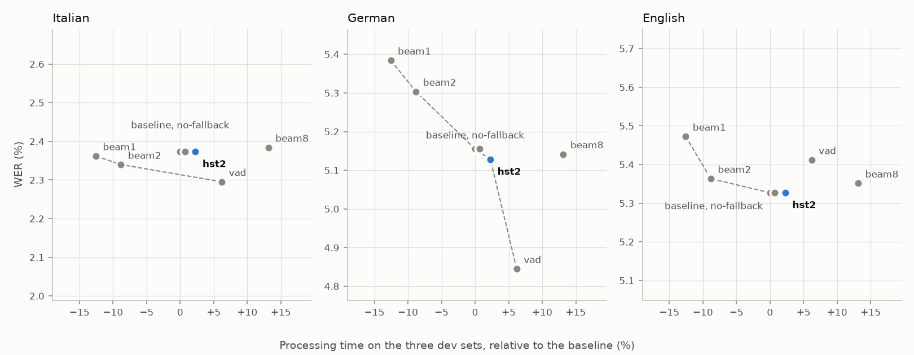
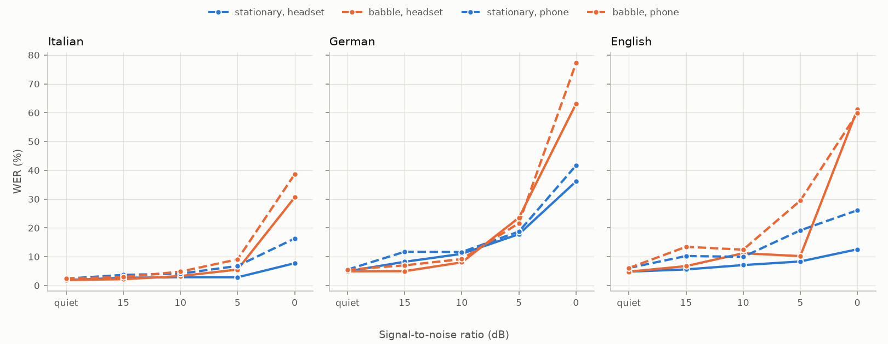

# ASR Lab: results

This document collects every experiment run so far, with its method, results and limitations. It
grows with each experiment. All tables are generated from the JSON results committed in
[`experiments/`](experiments/) by `asr-lab render-results`, and a test fails if a table no longer
matches them, so the numbers below cannot drift from the data. Each chapter ends with the command
that regenerates it.

**Contents**
1. [Executive summary](#executive-summary)
2. [Setup](#setup): data, models, metrics, statistics, hardware
3. [E1. Baseline](#e1-baseline)
4. [E2. Which decoding settings?](#e2-which-decoding-settings)
5. [E3. How much does text normalization change WER?](#e3-how-much-does-text-normalization-change-wer)
6. [E10. Usage analytics: where should a product team invest?](#e10-usage-analytics-where-should-a-product-team-invest)
   (simulated traffic, real audio and errors)
7. [Limitations and next steps](#limitations-and-next-steps)

## Executive summary

- **Baseline in three languages.** On the FLEURS test sets, Whisper-small (faster-whisper, int8,
  beam size 5) reaches **6.66% WER in English** (95% CI [5.98, 7.36]), **7.46% in Italian**
  ([6.81, 8.08]) and **9.31% in German** ([8.58, 10.11]); Whisper-base reaches 10.03%, 16.09% and
  18.07%.
- **Large models: 2.26% WER in Italian.** Whisper-large-v3 (float16, GPU) reaches 2.26% in Italian
  (95% CI [1.93, 2.64]), 4.02% in German and 4.62% in English. The language ranking reverses:
  English, easiest for the small models, is now the hardest, partly because the simple English
  normalizer counts British versus American spellings as errors. large-v3-turbo is about twice as
  fast and 0.4 points worse in every language.
- **The benefit of a larger model depends on the language.** Whisper-small removes about half of
  Whisper-base's word errors in Italian (54%) and German (48%), but only a third in English (34%),
  where the smaller model is already much better.
- **Language is confounded with speaker gender.** The German test set has only male voices and the
  Italian one is 96% female, so the gaps between languages cannot be attributed to the language
  alone.
- **Decoding settings matter little for WER; voice activity detection matters for
  hallucinations.** In a sweep on the dev sets, beam size, temperature fallback and Whisper's
  hallucination-silence threshold move large-v3-turbo's WER by at most a quarter of a point.
  Voice activity detection lowers German WER by 0.31 points on dev ([-0.59, -0.03]) and removes
  the invented "Vielen Dank" endings (12 to 0 on the German test set), for 6% more processing
  time. The pre-registered selection rule picked the hallucination-silence threshold, which is in
  practice the baseline, after a borderline comparison: an example of why such a rule needs a
  non-inferiority margin.
- **Normalization is a large hidden variable.** On the same Whisper-small Italian transcripts, WER
  ranges from 13.87% with no normalization to 7.15% with the most complete Italian normalizer.
  Almost half of the raw word errors are casing, punctuation and formatting.
- **A widely used normalizer can make results worse.** Whisper's own basic normalizer deletes text
  in parentheses. In FLEURS that text is read aloud (103 of 865 references), so correctly
  transcribed words become insertions: +1.87 WER points (95% CI [1.03, 2.79]) compared with a
  simple lowercase-and-punctuation normalizer.
- **Rankings are stable, relative improvements are not.** Whisper-small beats Whisper-base by 8.6
  to 9.3 points under every normalizer, but the relative error reduction it would be credited with
  ranges from 40% (no normalization) to 55%.
- **Numbers matter.** Writing numbers, symbols and units in words (`it-v2`) lowers Whisper-small's
  WER by 0.31 points (95% CI [0.15, 0.48]) and removes most digit/symbol substitutions (56 to 10).
- **In simulated usage, competing speakers are the problem, and confidence helps find it.** On
  3,000 sessions with simulated traffic but real noise, telephone degradations and transcripts,
  large-v3-turbo's WER is 3.56% in quiet rooms and 45.47% with babble at 0 dB on a headset, where
  it transcribes a background voice instead of the speaker in 12.6% of the sessions. Babble
  segments hold 41.5% of all errors as avoidable, the telephone channel alone under 2%. Reviewing
  the least confident 5% of sessions catches 34% of all word errors, while a simulated correction
  rate understates how bad the worst conditions are.

## Setup

### Data

FLEURS (Google), test splits for Italian, German and English (US), downloaded from the Hugging Face
Hub and converted to 16 kHz mono 16-bit WAV with a JSONL manifest. FLEURS is built on FLoRes, a
corpus of Wikipedia sentences translated into many languages, and the three test sets read almost
the same sentences: 343 of them are in all three. The content is therefore close to parallel
across languages, while the speakers are different.

| | Italian | German | English |
|---|---|---|---|
| Utterances | 865 | 862 | 647 |
| Hours of audio | 3.52 | 3.15 | 1.77 |
| Distinct sentences | 346 | 347 | 350 |
| Duration per utterance (median) | 5.3-52.9 s (13.9 s) | 3.6-47.9 s (11.4 s) | 3.6-29.3 s (9.5 s) |
| Speaker gender (utterances) | 827 female, 38 male | 862 male | 412 female, 235 male |

Each sentence is read by one to three speakers (two at most in English). FLEURS does not provide
speaker ids, so readings of the same sentence are the only known source of correlation between
utterances (see Statistics). References are the original transcripts with casing and punctuation;
in Italian, 103 contain text in parentheses that is read aloud.

The gender balance differs completely between languages: German is all male, Italian almost all
female. Language and gender are therefore confounded, and no Italian result should be read as
representative of male voices or German result of female voices.

### Models

| | |
|---|---|
| Models | Whisper-base, Whisper-small, Whisper-large-v3-turbo and Whisper-large-v3 (OpenAI), through faster-whisper 1.2.1 (CTranslate2) |
| Precision | int8 weights on the CPU, float16 on the GPU |
| Decoding | beam size 5, language forced to the test set's language, `condition_on_previous_text` disabled, no voice activity detection |
| Hardware | base and small: 12-core ARM64 laptop CPU (Snapdragon X Elite), WSL2 Ubuntu, 4 threads; large models and a bridge run of small: NVIDIA T4 GPU on Google Colab |
| Speed (CPU) | real-time factor 0.11-0.20 for small (24 min for 3.5 h of Italian audio) and 0.06-0.11 for base; German was the slowest language for both models. GPU speeds are in [E1](#larger-models-on-a-gpu) |

faster-whisper was chosen after a benchmark on this machine: it was about six times faster than
the PyTorch implementation, and more than 4 threads made it slower
([decision 11](docs/design.md#11-local-whisper-inference-with-faster-whisper-int8-4-threads)).

### Metrics

- **Word and character error rate at corpus level**: total substitutions, deletions and insertions
  divided by the total number of reference words (or characters), never the mean of per-utterance
  rates. The alignment is implemented in the project and cross-checked against jiwer.
- **Normalization** is applied identically to references and hypotheses before scoring. Every
  result states its normalizer; the normalizers are described in [E3](#normalizers-compared).
- Raw predictions are saved, so every score can be recomputed with another normalizer or
  statistic without running the models again.

### Statistics

- **Confidence intervals**: percentile bootstrap, 1,000 resamples, fixed seed. Readings of the same
  sentence have correlated errors (a hard proper noun is hard for every reader), so intervals are
  computed both resampling utterances and resampling sentences; the widest is reported. In
  practice the sentence-level interval is always the widest, 19% to 46% wider than the
  utterance-level one.
- **Comparisons** between two systems, or two normalizers, use the paired bootstrap: each
  replicate draws the same sentences for both sides, and the interval of the difference is
  reported. Two separate intervals can overlap while the paired difference is clearly significant
  (see `it-v1 → it-v2` below): overlap is not a test.
- "B better in" is the fraction of bootstrap replicates in which B has the lower error rate.

## E1. Baseline

**Question.** How accurate are off-the-shelf multilingual Whisper models, from Whisper-base to
Whisper-large-v3, on read speech in Italian, German and English, and how much does a larger model
gain in each language?

**Method.** Each model transcribes each test set once, with the settings in [Setup](#models):
Whisper-base and Whisper-small on the CPU, the large models on a GPU (see
[below](#larger-models-on-a-gpu)).
Transcripts are scored with the normalizer of their language: `it-v1`, `de-v1` (`basic-v1` plus
"ß" → "ss") and `en-v1` (`basic-v1`); see [E3](#normalizers-compared) for what they do. Models are
compared with the paired bootstrap within each language. Languages are compared only
descriptively: the utterances differ, so no paired test is possible between them.

<!-- BEGIN e1-baseline -->
| System | Normalizer | Utterances / words | WER [95% CI] | S / D / I | CER [95% CI] |
|---|---|---|---|---|---|
| Italian · Whisper-small | `it-v1` | 865 / 21,255 | 7.46% [6.81%, 8.08%] | 1,223 / 169 / 193 | 2.11% [1.87%, 2.37%] |
| Italian · Whisper-base | `it-v1` | 865 / 21,255 | 16.09% [15.13%, 17.12%] | 2,595 / 402 / 422 | 4.16% [3.84%, 4.49%] |
| German · Whisper-small | `de-v1` | 862 / 18,703 | 9.31% [8.58%, 10.11%] | 1,335 / 165 / 242 | 2.58% [2.32%, 2.88%] |
| German · Whisper-base | `de-v1` | 862 / 18,703 | 18.07% [16.91%, 19.31%] | 2,564 / 283 / 532 | 5.28% [4.92%, 5.73%] |
| English · Whisper-small | `en-v1` | 647 / 14,467 | 6.66% [5.98%, 7.36%] | 708 / 101 / 154 | 2.75% [2.43%, 3.08%] |
| English · Whisper-base | `en-v1` | 647 / 14,467 | 10.03% [9.09%, 10.99%] | 1,047 / 140 / 264 | 4.39% [3.95%, 4.82%] |
<!-- END e1-baseline -->

<!-- BEGIN e1-model-gap -->
| Comparison | A | B | B - A [95% CI] | B better in | Significant |
|---|---|---|---|---|---|
| Italian: base → small | 16.09% | 7.46% | -8.63% [-9.38%, -7.89%] | 100.0% | yes |
| German: base → small | 18.07% | 9.31% | -8.75% [-9.70%, -7.89%] | 100.0% | yes |
| English: base → small | 10.03% | 6.66% | -3.37% [-3.98%, -2.76%] | 100.0% | yes |
<!-- END e1-model-gap -->

### Findings: Whisper-base and Whisper-small

1. **English is the easiest language for both models, German the hardest.** Whisper-small reaches
   6.66% WER in English, 7.46% in Italian and 9.31% in German. The English and Italian intervals
   overlap; German is clearly behind. The ranking is the same for Whisper-base (10.03%, 16.09%,
   18.07%). CER ranks the languages differently: for Whisper-small English has the highest CER
   (2.75%, against 2.11% for Italian), so even the choice between WER and CER changes which
   language looks easiest.
2. **The larger model is always significantly better, but by how much depends on the language.**
   Whisper-small removes 54% of Whisper-base's word errors in Italian, 48% in German and only 34%
   in English, where Whisper-base is already much better. A plausible explanation is that English
   dominates Whisper's training data, so even the smaller model has seen enough of it; these
   experiments do not test that explanation.
3. **Most errors are substitutions in every language**, spread over hundreds of distinct word pairs
   (885 in Italian, 1,059 in German, 548 in English for Whisper-small): there is no single dominant
   error to fix.

**Speaker gender.** Language and gender are confounded (see [Data](#data)), so the gap between
German and the other languages may be partly a gender effect. Within a language, the scores can be
split by gender only where both are present; the subsets read different sentences, so these
figures are descriptive, not a test:

| Whisper-small, WER [95% CI] | Female | Male |
|---|---|---|
| Italian (827 / 38 utterances) | 7.17% [6.57, 7.78] | 13.67% [10.22, 17.81] |
| English (412 / 235 utterances) | 6.41% [5.64, 7.20] | 7.09% [5.91, 8.38] |

In English the two groups are close and their intervals overlap widely. The Italian male subset is
almost twice as hard, but it has 38 utterances from an unknown, probably very small, number of
speakers, so it says more about those speakers than about male voices in general. These figures
were computed with a one-off script, not with a committed command, which is why they are not in a
generated table.

### Error analysis: Whisper-small

The most frequent errors (`asr-lab errors`, Whisper-small) are different in each language, and
many of them are about writing conventions rather than recognition.

**Italian.**
- **Formatting rather than recognition**: abbreviations and numbers ("km" vs "chilometri"), elided
  forms ("delle" vs "dell'"). Experiment E3 measures how much of the WER they account for.
- **"e" (and) and "è" (is)**, which sound almost the same, confused 22 times: a context error that a
  language model could help with.
- **Rare proper nouns** replaced by frequent words that sound alike: *Geospiza* became
  "joe s pizza", *Martelly* became "Martelli".
- **Hallucination**: in 5 of 865 utterances Whisper appends "Sottotitoli (e revisione) a cura di
  QTSS" ("subtitles by QTSS"), text learned from subtitled videos in its training data, which
  never occurs in the references. No such text appears in the German or English transcripts.

**German.**
- **Compounds.** German writes compound nouns as one word, and speakers do not pause between their
  parts, so the model has to decide where a word ends. A simple check (a reference word that the
  hypothesis writes as two consecutive words, or the reverse) finds 86 compounds split by
  Whisper-small and 45 words joined. Each costs two word errors: one substitution plus one
  insertion or deletion. Part of this is a normalization artifact: `de-v1` turns hyphens into
  spaces, so the reference "Schengen-Raum" becomes two words while the model's "Schengenraum" is
  one; "Schengen" is among the most deleted words (8 times).
- **Abbreviations**: "n. Chr." (*nach Christus*, AD) and "usw." (*und so weiter*, etc.) are written
  in full by the model, and "km" as "Kilometer": about 25 substitutions, all formatting.
- **Short function words** that differ by one sound: "einen" vs "ein", "zum" vs "zu", "im" vs "in",
  "von" vs "vom". Whisper-base also confuses "das" (the, that) and "dass" (that, conjunction) 17
  times; they sound the same and differ only in grammar.

**English.**
- **Spelling variants**: the references use British spelling and the model American spelling
  ("travellers" vs "travelers", 7 times). `en-v1` does not map spelling variants (Whisper's English
  normalizer does), so these are counted as errors.
- **Short, unstressed words**: "in" heard as "and" 15 times, "a" and "the" swapped 18 times, and
  "the", "a", "to" are the most frequent deletions and insertions.
- **Numbers**: 61 substitutions involve digits or symbols, more than in Italian (56) although
  English has fewer words: `en-v1`, like `de-v1`, does not write numbers in words.

**Interpretation.** WER differences between languages mix three things: how hard the language is
for the model, who the speakers are, and how well the normalizer fits the language's writing
conventions. The normalizers for German and English are much simpler than `it-v2` (E3), so their
WER is probably inflated by formatting errors that `it-v2` would remove in Italian.

### Larger models on a GPU

Whisper-large-v3-turbo and Whisper-large-v3 were transcribed in float16 on a Colab T4 GPU
([notebook](notebooks/e1_large_colab.ipynb)), together with a *bridge* run of Whisper-small on the
same GPU: comparing it with the CPU int8 run of the same model measures the effect of hardware and
precision alone, so that the model comparisons below are not confounded with it.

<!-- BEGIN e1-gpu -->
| System | Normalizer | Utterances / words | WER [95% CI] | S / D / I | CER [95% CI] |
|---|---|---|---|---|---|
| Italian · Whisper-small | `it-v1` | 865 / 21,255 | 7.43% [6.80%, 8.09%] | 1,225 / 176 / 178 | 2.07% [1.85%, 2.29%] |
| Italian · Whisper-large-v3-turbo | `it-v1` | 865 / 21,255 | 2.64% [2.23%, 3.07%] | 450 / 52 / 59 | 0.85% [0.67%, 1.04%] |
| Italian · Whisper-large-v3 | `it-v1` | 865 / 21,255 | 2.26% [1.93%, 2.64%] | 387 / 52 / 42 | 0.75% [0.59%, 0.93%] |
| German · Whisper-small | `de-v1` | 862 / 18,703 | 9.13% [8.43%, 9.90%] | 1,303 / 168 / 237 | 2.54% [2.29%, 2.80%] |
| German · Whisper-large-v3-turbo | `de-v1` | 862 / 18,703 | 4.45% [3.91%, 5.01%] | 612 / 89 / 131 | 1.44% [1.20%, 1.69%] |
| German · Whisper-large-v3 | `de-v1` | 862 / 18,703 | 4.02% [3.52%, 4.56%] | 540 / 101 / 111 | 1.44% [1.18%, 1.74%] |
| English · Whisper-small | `en-v1` | 647 / 14,467 | 6.59% [5.93%, 7.27%] | 696 / 104 / 154 | 2.70% [2.39%, 3.03%] |
| English · Whisper-large-v3-turbo | `en-v1` | 647 / 14,467 | 5.00% [4.45%, 5.55%] | 517 / 110 / 97 | 2.13% [1.85%, 2.42%] |
| English · Whisper-large-v3 | `en-v1` | 647 / 14,467 | 4.62% [4.08%, 5.17%] | 488 / 100 / 80 | 2.05% [1.75%, 2.37%] |
<!-- END e1-gpu -->

<!-- BEGIN e1-gpu-gaps -->
| Comparison | A | B | B - A [95% CI] | B better in | Significant |
|---|---|---|---|---|---|
| Italian: small, CPU int8 → GPU float16 | 7.46% | 7.43% | -0.03% [-0.26%, +0.21%] | 61.1% | no |
| Italian: small → large-v3-turbo | 7.43% | 2.64% | -4.79% [-5.30%, -4.31%] | 100.0% | yes |
| Italian: large-v3-turbo → large-v3 | 2.64% | 2.26% | -0.38% [-0.59%, -0.15%] | 100.0% | yes |
| German: small, CPU int8 → GPU float16 | 9.31% | 9.13% | -0.18% [-0.37%, +0.01%] | 97.0% | no |
| German: small → large-v3-turbo | 9.13% | 4.45% | -4.68% [-5.26%, -4.15%] | 100.0% | yes |
| German: large-v3-turbo → large-v3 | 4.45% | 4.02% | -0.43% [-0.75%, -0.14%] | 100.0% | yes |
| English: small, CPU int8 → GPU float16 | 6.66% | 6.59% | -0.06% [-0.23%, +0.10%] | 73.8% | no |
| English: small → large-v3-turbo | 6.59% | 5.00% | -1.59% [-1.99%, -1.19%] | 100.0% | yes |
| English: large-v3-turbo → large-v3 | 5.00% | 4.62% | -0.39% [-0.69%, -0.12%] | 99.8% | yes |
<!-- END e1-gpu-gaps -->

**Hardware and precision alone do not change the results.** The bridge comparisons (Whisper-small,
CPU int8 → GPU float16) give -0.03 points in Italian (95% CI [-0.26, +0.21]), -0.18 in German
([-0.37, +0.01]) and -0.06 in English ([-0.23, +0.10]): none is significant. Not significant does
not mean zero, but any effect is at most a few tenths of a point, an order of magnitude below the
model differences, so the GPU comparisons below are comparisons of models and the CPU and GPU
tables can be read side by side.

**The large models are much better, and the gain again depends on the language.** From
Whisper-small to large-v3-turbo, WER drops by 4.79 points in Italian (65% of the errors), 4.68 in
German (51%) and 1.59 in English (24%). Over the whole range, from Whisper-small on the CPU to
large-v3, the reduction is 70%, 57% and 31%.

**The language ranking reverses.** Whisper-large-v3 reaches **2.26% in Italian** (95% CI
[1.93, 2.64]), **4.02% in German** ([3.52, 4.56]) and **4.62% in English** ([4.08, 5.17]): English,
the easiest language for the small models, is now the hardest, level with German. Part of this is
measurement rather than recognition. Substitutions involving digits or symbols stay at about the
same count for every model (Italian 60 for Whisper-small on the GPU and 55 for large-v3, German 50
and 49, English 54 and 53), so as recognition errors disappear, formatting takes a growing share:
in Italian, from 5% to 14% of the substitutions. In English, the most frequent substitutions of
large-v3 are British versus American spellings ("travellers" vs "travelers" 7 times, "travelling"
4, "theatre" 3), which `en-v1` counts as errors. With a simple normalizer, the better the model, the
more its WER measures writing conventions.

**large-v3-turbo is about twice as fast as large-v3 and slightly less accurate.** On the GPU it is
2.0 to 2.3 times faster; large-v3 is better by 0.38 points in Italian, 0.43 in German and 0.39 in
English (8% to 14% fewer errors), a significant difference in every language but a small one in
absolute terms.

| Real-time factor, T4 GPU, float16 | Italian | German | English | GPU minutes, 3 languages |
|---|---|---|---|---|
| Whisper-small | 0.023 | 0.024 | 0.025 | 12 |
| Whisper-large-v3-turbo | 0.034 | 0.037 | 0.044 | 19 |
| Whisper-large-v3 | 0.078 | 0.082 | 0.087 | 41 |

The turbo model has the encoder of large-v3 and 4 decoder layers instead of 32. The encoder does
much of the work, and utterances are transcribed one at a time, which adds a fixed cost per
utterance for every model: that is why it is not eight times faster, and why Whisper-small is only
3.4 times faster than large-v3. These factors were measured on a shared Colab machine and are not
comparable with the CPU ones in [Setup](#models).

**Larger models hallucinate more closing phrases in German.** Utterances whose transcript ends with
a phrase that is not in the reference, typical of subtitled videos in Whisper's training data
("Sottotitoli a cura di QTSS" and "grazie a tutti" in Italian, "Vielen Dank" and "Untertitelung des
ZDF 2020" in German, "thank you" in English):

<!-- BEGIN e1-closing-phrases -->
| Utterances with an invented closing phrase | small (CPU int8) | small | large-v3-turbo | large-v3 |
|---|---|---|---|---|
| Italian | 5 | 4 | 3 | 2 |
| German | 3 | 3 | 12 | 12 |
| English | 0 | 1 | 0 | 1 |
<!-- END e1-closing-phrases -->

In German, 10 of the 12 utterances are the same for large-v3-turbo and large-v3, which share their
encoder: something in those recordings triggers the phrase. Each case costs only two to six
insertions, so the effect on WER is small, but in a product an invented "Vielen Dank" at the end
of a dictated message is a visible error. Voice activity detection, disabled here, removes them
almost entirely ([E2](#e2-which-decoding-settings)). The counts are part of the error report
(`asr-lab errors`), which matches a short list of known phrases at the end of the normalized
transcript when the reference does not end the same way.

**Speaker gender** (Whisper-large-v3, descriptive as above): Italian 2.19% for female voices
([1.86, 2.56]) and 3.88% for the 38 male utterances ([2.03, 6.20]); English 4.40% ([3.77, 5.03])
and 5.01% ([4.15, 6.04]). The intervals overlap in both languages.

### Limitations

- Language is confounded with speaker gender, and speaker ids are not available.
- `de-v1` and `en-v1` handle neither numbers nor abbreviations, `de-v1` splits hyphenated
  compounds and `en-v1` keeps spelling variants. Comparing languages fairly needs normalizers of
  similar coverage.
- The test sets are small (1.8 to 3.5 hours) and contain read Wikipedia text only.
- No correction for multiple comparisons is applied to the twelve comparisons of this chapter.
  The nine model comparisons have the larger model better in at least 99.8% of the 1,000
  replicates; the one closest to a Bonferroni-corrected threshold is English large-v3-turbo →
  large-v3 (99.8%), which more resamples would be needed to settle.
- The large models ran on a different machine (Colab T4 GPU, float16). The bridge run shows that
  this does not change accuracy measurably, but speeds are not comparable across machines.
- Hallucinated closing phrases are counted by matching a short list of known phrases, so other
  invented endings are missed.

E1 will be extended to other model families (wav2vec2 with CTC, Transducers).

**Reproduce:** `bash experiments/E1/run.sh` (or `experiments/E1/run.ps1` on Windows). With the
committed transcripts it only rescores. Without them it downloads the three test sets and
transcribes them with Whisper-small and Whisper-base (about two hours on a laptop CPU); the GPU
runs are transcribed with [`notebooks/e1_large_colab.ipynb`](notebooks/e1_large_colab.ipynb) on a
Colab GPU (about 75 minutes of transcription on a T4, plus the download).

## E2. Which decoding settings?

**Question.** E1 used fixed decoding settings. Do the usual alternatives (a smaller or larger
beam, no temperature fallback, voice activity detection, Whisper's hallucination-silence
threshold) make large-v3-turbo more accurate or faster, and which settings should a product use?

**Method.**
- **One factor at a time.** Each configuration changes one option of the E1 settings (beam size 5,
  temperature fallback on, no voice activity detection), listed in
  [`experiments/E2/sweep.toml`](experiments/E2/sweep.toml).
- **Tuned on dev, confirmed on test.** Every configuration transcribes the three FLEURS dev sets
  (Italian 391 utterances / 9,018 words, German 363 / 7,410, English 394 / 8,241; no sentence is
  shared with the test sets), in one Colab session on a T4 GPU, with the model loaded once and a
  warm-up before timing. The baseline configuration is run a second time at the end of the session
  (`baseline-repeat`): this measures run-to-run variation, both in the transcripts and in the
  timings.
- **One configuration for all languages, chosen by a rule fixed before the runs**
  (`asr-lab select`, [decision 22](docs/design.md#22-decoding-options-are-chosen-on-the-dev-set-by-a-rule-written-in-code)).
  In each language, find the configuration with the lowest WER. A configuration is eligible if a
  paired bootstrap does not find it significantly worse than that best one in any language. Among
  the eligible ones, pick the fastest, by total processing time over the three dev sets. If none
  is eligible, keep the baseline.
- **The test sets are used once**, for the selected configuration only, against the E1 run of
  large-v3-turbo, which has the baseline settings. Voice activity detection was also run on the
  test sets, as an **exploratory** comparison decided after seeing the dev results (see below).

### Results on the dev sets

The selection, as computed by `asr-lab select` (best WER of each language in bold; times are the
total over the three dev sets):

<!-- BEGIN e2-selection -->
| Configuration | Change from the baseline | WER it | WER de | WER en | RTF | Time vs baseline | Eligible |
|---|---|---|---|---|---|---|---|
| baseline | none | 2.37% | 5.16% | **5.33%** | 0.037 | +0.0% | no |
| beam1 | `beam_size = 1` | 2.36% | 5.38% | 5.47% | 0.033 | -12.6% | no |
| beam2 | `beam_size = 2` | 2.34% | 5.30% | 5.36% | 0.034 | -8.8% | no |
| beam8 | `beam_size = 8` | 2.38% | 5.14% | 5.35% | 0.042 | +13.1% | no |
| no-fallback | `temperature = [0.0]` | 2.37% | 5.16% | 5.33% | 0.038 | +0.7% | no |
| vad | `vad_filter = True` | **2.30%** | **4.84%** | 5.41% | 0.040 | +6.2% | yes |
| **hst2** (selected) | `hallucination_silence_threshold = 2.0` | 2.37% | 5.13% | 5.33% | 0.038 | +2.3% | yes |
| baseline-repeat | none | 2.37% | 5.16% | 5.33% | 0.038 | +0.6% | n/a |
<!-- END e2-selection -->

*Each point is a configuration; the dashed line joins the configurations that no other one beats
on both WER and time (the Pareto front); the selected one is blue. The WER axis spans the same
number of points in every panel.*

Effect of each option against the baseline (B - A, negative when the option lowers WER):

<!-- BEGIN e2-dev-effects -->
| Comparison | A | B | B - A [95% CI] | B better in | Significant |
|---|---|---|---|---|---|
| Italian: beam1 | 2.37% | 2.36% | -0.01% [-0.16%, +0.13%] | 55.0% | no |
| Italian: beam2 | 2.37% | 2.34% | -0.03% [-0.16%, +0.07%] | 67.4% | no |
| Italian: beam8 | 2.37% | 2.38% | +0.01% [+0.00%, +0.04%] | 0.0% | no |
| Italian: no-fallback | 2.37% | 2.37% | +0.00% [+0.00%, +0.00%] | 0.0% | no |
| Italian: vad | 2.37% | 2.30% | -0.08% [-0.25%, +0.10%] | 78.6% | no |
| Italian: hst2 | 2.37% | 2.37% | +0.00% [+0.00%, +0.00%] | 0.0% | no |
| Italian: baseline-repeat | 2.37% | 2.37% | +0.00% [+0.00%, +0.00%] | 0.0% | no |
| German: beam1 | 5.16% | 5.38% | +0.23% [+0.00%, +0.48%] | 2.0% | no |
| German: beam2 | 5.16% | 5.30% | +0.15% [-0.01%, +0.35%] | 3.5% | no |
| German: beam8 | 5.16% | 5.14% | -0.01% [-0.10%, +0.07%] | 56.6% | no |
| German: no-fallback | 5.16% | 5.16% | +0.00% [+0.00%, +0.00%] | 0.0% | no |
| German: vad | 5.16% | 4.84% | -0.31% [-0.59%, -0.03%] | 98.3% | yes |
| German: hst2 | 5.16% | 5.13% | -0.03% [-0.07%, +0.00%] | 86.3% | no |
| German: baseline-repeat | 5.16% | 5.16% | +0.00% [+0.00%, +0.00%] | 0.0% | no |
| English: beam1 | 5.33% | 5.47% | +0.15% [+0.01%, +0.30%] | 1.8% | yes |
| English: beam2 | 5.33% | 5.36% | +0.04% [-0.09%, +0.17%] | 26.6% | no |
| English: beam8 | 5.33% | 5.35% | +0.02% [-0.06%, +0.12%] | 23.9% | no |
| English: no-fallback | 5.33% | 5.33% | +0.00% [+0.00%, +0.00%] | 0.0% | no |
| English: vad | 5.33% | 5.41% | +0.08% [-0.13%, +0.30%] | 21.2% | no |
| English: hst2 | 5.33% | 5.33% | +0.00% [+0.00%, +0.00%] | 0.0% | no |
| English: baseline-repeat | 5.33% | 5.33% | +0.00% [+0.00%, +0.00%] | 0.0% | no |
<!-- END e2-dev-effects -->

Utterances with an invented closing phrase (see [E1](#larger-models-on-a-gpu)):

<!-- BEGIN e2-closing-phrases-dev -->
| Utterances with an invented closing phrase | baseline | beam1 | beam2 | beam8 | no-fallback | vad | hst2 | baseline-repeat |
|---|---|---|---|---|---|---|---|---|
| Italian (dev) | 2 | 2 | 2 | 2 | 2 | 1 | 3 | 2 |
| German (dev) | 2 | 2 | 2 | 3 | 2 | 0 | 2 | 2 |
| English (dev) | 1 | 1 | 1 | 1 | 1 | 0 | 1 | 1 |
<!-- END e2-closing-phrases-dev -->

### Results on the test sets

The E1 run of large-v3-turbo (baseline settings) against the selected configuration and against
voice activity detection:

<!-- BEGIN e2-test -->
| Comparison | A | B | B - A [95% CI] | B better in | Significant |
|---|---|---|---|---|---|
| Italian: baseline → hst2 (selected) | 2.64% | 2.64% | +0.00% [-0.03%, +0.03%] | 35.4% | no |
| Italian: baseline → vad (exploratory) | 2.64% | 2.70% | +0.06% [-0.09%, +0.19%] | 21.7% | no |
| German: baseline → hst2 (selected) | 4.45% | 4.46% | +0.01% [-0.01%, +0.04%] | 14.8% | no |
| German: baseline → vad (exploratory) | 4.45% | 4.25% | -0.20% [-0.41%, +0.01%] | 96.6% | no |
| English: baseline → hst2 (selected) | 5.00% | 5.02% | +0.01% [+0.00%, +0.04%] | 0.0% | no |
| English: baseline → vad (exploratory) | 5.00% | 4.94% | -0.07% [-0.24%, +0.11%] | 77.0% | no |
<!-- END e2-test -->

<!-- BEGIN e2-closing-phrases-test -->
| Utterances with an invented closing phrase | baseline (E1) | hst2 (selected) | vad (exploratory) |
|---|---|---|---|
| Italian (test) | 3 | 2 | 2 |
| German (test) | 12 | 13 | 0 |
| English (test) | 0 | 0 | 0 |
<!-- END e2-closing-phrases-test -->

### Findings

1. **Decoding is deterministic, and the temperature fallback never triggers on this data.**
   `baseline-repeat` produces the same transcripts as `baseline` in all 1,148 dev utterances, and
   so does `no-fallback`: the fallback re-decodes a segment at a higher temperature only when the
   output looks wrong (too repetitive or too unlikely), and on short read sentences it never did.
   Timings vary by about 1% between identical runs, so smaller speed differences are noise.
2. **The beam size changes speed more than accuracy.** Greedy decoding (`beam1`) is 12.6% faster
   than beam 5 and worse in German (+0.23 points) and English (+0.15, the only beam effect
   significant before correction). A beam of 8 is 13.1% slower and changes nothing. Beam 5, the
   default, is a reasonable setting for this model.
3. **Voice activity detection is the only option with a clear effect on accuracy.** It lowers WER
   in German by 0.31 points on dev (95% CI [-0.59, -0.03]), mostly by removing insertions and
   substitutions (S/D/I from 300/50/32 to 285/48/26), and removes almost every invented closing
   phrase: on dev, 5 to 1 over the three languages; on the test sets, the 12 German ones of E1
   disappear. It changes about a quarter of the transcripts (100, 86 and 79 dev utterances) and
   costs 6.2% more processing time.
4. **The selected configuration, `hst2`, is in practice the baseline.** The hallucination-silence
   threshold acts only on silences longer than 2 seconds around a suspicious segment, which short
   read utterances rarely contain: it changes 2 Italian and 2 German dev transcripts and none in
   English. On the test sets it is indistinguishable from E1 (+0.00, +0.01 and +0.01 points, none
   significant) and keeps the German closing phrases (13 against 12).
5. **The selection was decided by a borderline comparison.** Only `vad` and `hst2` are eligible.
   The baseline is excluded because it is significantly worse than `vad` in German (+0.31,
   [+0.03, +0.59]), while `hst2`, which differs from it in two German transcripts, is not
   (+0.28, [-0.01, +0.56]). The rule then picks `hst2` as the faster of the two (+2.3% against
   +6.2%). The rule works as written, but "not significantly worse" is not "equivalent": a
   configuration whose interval reaches +0.56 points is not shown to be as good. A rule with a
   non-inferiority margin (eligible only if the upper bound of the difference stays below a fixed
   margin) would make this explicit: with a margin of half a point it would have excluded `hst2`
   and the baseline (+0.56 and +0.59 in German) and kept `vad` (+0.30, in English), while a margin
   of 0.2 points would have excluded every configuration. Choosing the margin now, after seeing
   these numbers, would choose the result, so it is left for the next sweep, fixed in advance.
6. **On the test sets, voice activity detection confirms its direction in German but not
   significantly.** As an exploratory comparison, it gives -0.20 points in German ([-0.41, +0.01],
   lower in 96.6% of the replicates), -0.07 in English and +0.06 in Italian, none significant.
   It again removes insertions (German 131 to 92) but adds deletions (Italian 52 to 65, German 89
   to 101); among the deleted words are numbers (German, 5 to 14 deleted words with digits), as if
   short segments were cut. This pattern does not appear on dev and is based on few words, so it
   is an observation to check, not a finding.

**Interpretation.** For large-v3-turbo on read speech, the decoding settings matter little for WER:
apart from voice activity detection, no option moves it by more than a quarter of a point. The
practical choice is between the baseline and voice activity detection, and it is about
hallucinations rather than WER: VAD removes the invented closing phrases, which are rare but very
visible to a user, at the cost of about 6% of processing time and possibly a few deleted words.
For a dictation product we would adopt VAD and monitor deletions; the pre-registered rule, as
written, selected `hst2`, and that is the result reported here.

### Limitations

- **Multiple comparisons.** The dev table has 21 comparisons (18 options and 3 repeats). The two
  significant ones (`vad` in German and `beam1` in English) have B better in 98.3% and 1.8% of the
  replicates, which a Bonferroni correction for 21 comparisons would not accept. The selection
  rule itself compares every configuration with the best one of each language without
  correction; a correction would make more configurations eligible, not fewer.
- **Winner's curse.** The best configuration of each language on dev is partly best by chance, so
  its dev WER is optimistic; the test runs, used once, are the unbiased estimate.
- **The VAD test run is exploratory.** It was decided after seeing the dev results and is not
  covered by the selection rule. Its speed was measured in a different Colab session from the E1
  run it is compared with (about 5-8% slower, in line with the +6.2% on dev), so test speeds are
  only indicative.
- **Read speech only.** FLEURS utterances are short (test medians 9.5 to 13.9 seconds), with
  little silence or noise. Voice activity detection and the hallucination-silence threshold are
  designed for long recordings with pauses, where their effect is likely to be larger.
- Options were varied one at a time; their interactions (for example VAD with a smaller beam) were
  not tested.

**Reproduce:** `bash experiments/E2/run.sh` (or `experiments/E2/run.ps1` on Windows). With the
committed transcripts it only rescores, compares, selects and redraws the figure (the figure needs
`uv sync --extra plots`). The transcripts are produced with
[`notebooks/e2_decoding_colab.ipynb`](notebooks/e2_decoding_colab.ipynb) on a Colab GPU (about two
hours on a T4 for the dev sweep, plus the download).

## E3. How much does text normalization change WER?

**Question.** Text normalization decides which differences between a reference and a model output
count as errors. How much does this choice change the WER of a given model, and can it change the
conclusions drawn when comparing two models?

### Normalizers compared

| Normalizer | What it does |
|---|---|
| `none` | no change |
| `basic-v1` | Unicode NFC, unify apostrophes, lowercase, remove punctuation (keeping apostrophes inside words), collapse whitespace |
| `whisper-basic` | reimplementation of OpenAI Whisper's `BasicTextNormalizer`, the usual choice for non-English text in papers and leaderboards: lowercase, delete text in brackets and parentheses, replace every mark, symbol and punctuation character (apostrophes included) with a space |
| `it-v1` | `basic-v1`, then split Italian elisions ("l'uomo" → "l uomo") |
| `it-v2` | `it-v1` plus numbers, symbols and unambiguous units in words: "2.000" → "duemila", "3,5" → "tre virgola cinque", "10:30" → "dieci e trenta", "$5" → "cinque dollari", "km" → "chilometri", "vent'anni" → "venti anni" |

**Method.** The saved transcripts of Whisper-small and Whisper-base (E1) are scored with each
normalizer, without running the models again. Normalizers are compared with the paired bootstrap
on the same Whisper-small transcripts; the two models are compared under each normalizer.

### Results

Whisper-small, the same transcripts scored with each normalizer:

<!-- BEGIN e3-normalizers-small -->
| System | Normalizer | Utterances / words | WER [95% CI] | S / D / I | CER [95% CI] |
|---|---|---|---|---|---|
| Whisper-small | `none` | 865 / 20,605 | 13.87% [12.85%, 14.91%] | 2,455 / 184 / 218 | 3.42% [3.12%, 3.76%] |
| Whisper-small | `basic-v1` | 865 / 20,701 | 7.69% [7.06%, 8.34%] | 1,194 / 196 / 202 | 2.14% [1.90%, 2.40%] |
| Whisper-small | `whisper-basic` | 865 / 20,787 | 9.56% [8.44%, 10.75%] | 1,178 / 159 / 651 | 4.12% [3.31%, 5.07%] |
| Whisper-small | `it-v1` | 865 / 21,255 | 7.46% [6.81%, 8.08%] | 1,223 / 169 / 193 | 2.11% [1.87%, 2.37%] |
| Whisper-small | `it-v2` | 865 / 21,262 | 7.15% [6.49%, 7.78%] | 1,171 / 158 / 191 | 1.88% [1.66%, 2.13%] |
<!-- END e3-normalizers-small -->

Whisper-base, the same comparison:

<!-- BEGIN e3-normalizers-base -->
| System | Normalizer | Utterances / words | WER [95% CI] | S / D / I | CER [95% CI] |
|---|---|---|---|---|---|
| Whisper-base | `none` | 865 / 20,605 | 23.13% [21.95%, 24.30%] | 3,859 / 440 / 467 | 5.81% [5.43%, 6.22%] |
| Whisper-base | `basic-v1` | 865 / 20,701 | 16.43% [15.51%, 17.45%] | 2,513 / 441 / 448 | 4.21% [3.89%, 4.54%] |
| Whisper-base | `whisper-basic` | 865 / 20,787 | 18.20% [16.78%, 19.74%] | 2,529 / 383 / 871 | 6.16% [5.34%, 7.09%] |
| Whisper-base | `it-v1` | 865 / 21,255 | 16.09% [15.13%, 17.12%] | 2,595 / 402 / 422 | 4.16% [3.84%, 4.49%] |
| Whisper-base | `it-v2` | 865 / 21,262 | 15.79% [14.86%, 16.82%] | 2,537 / 396 / 425 | 3.89% [3.59%, 4.21%] |
<!-- END e3-normalizers-base -->

Paired differences between normalizers (Whisper-small; B - A, negative when B gives a lower WER):

<!-- BEGIN e3-normalizer-comparisons -->
| Comparison | A | B | B - A [95% CI] | B better in | Significant |
|---|---|---|---|---|---|
| none → basic-v1 | 13.87% | 7.69% | -6.18% [-6.89%, -5.48%] | 100.0% | yes |
| basic-v1 → it-v1 | 7.69% | 7.46% | -0.23% [-0.36%, -0.12%] | 100.0% | yes |
| it-v1 → it-v2 | 7.46% | 7.15% | -0.31% [-0.48%, -0.15%] | 100.0% | yes |
| basic-v1 → whisper-basic | 7.69% | 9.56% | +1.87% [+1.03%, +2.79%] | 0.0% | yes |
<!-- END e3-normalizer-comparisons -->

Difference between the two models under each normalizer (A = Whisper-base, B = Whisper-small):

<!-- BEGIN e3-model-gap -->
| Comparison | A | B | B - A [95% CI] | B better in | Significant |
|---|---|---|---|---|---|
| base → small, `none` | 23.13% | 13.87% | -9.26% [-10.09%, -8.51%] | 100.0% | yes |
| base → small, `basic-v1` | 16.43% | 7.69% | -8.74% [-9.47%, -8.01%] | 100.0% | yes |
| base → small, `whisper-basic` | 18.20% | 9.56% | -8.64% [-9.42%, -7.92%] | 100.0% | yes |
| base → small, `it-v1` | 16.09% | 7.46% | -8.63% [-9.38%, -7.89%] | 100.0% | yes |
| base → small, `it-v2` | 15.79% | 7.15% | -8.64% [-9.39%, -7.91%] | 100.0% | yes |
<!-- END e3-model-gap -->

### Findings

1. **Casing and punctuation account for almost half of the raw errors.** Lowercasing and removing
   punctuation (`none` → `basic-v1`) lowers Whisper-small's WER from 13.87% to 7.69%. Reporting an
   unnormalized WER, or comparing it with a normalized one, misrepresents a model by a factor of
   almost two.
2. **Language-specific rules matter, even when small.** Splitting elisions (`it-v1`) and writing
   numbers, symbols and units in words (`it-v2`) each give a small but significant improvement
   (-0.23 and -0.31 points). With `it-v2`, substitutions involving digits or symbols drop from 56
   to 10 in the error analysis: most of them were not recognition errors.
3. **A standard normalizer can be wrong for a dataset.** `whisper-basic` deletes everything in
   parentheses, as if it were an annotation such as "(laughs)". In FLEURS, parentheses contain
   spoken text, so the words disappear from the reference and the model is penalized for
   transcribing them: insertions jump from 202 to 651 and WER rises by 1.87 points (Whisper-small)
   compared with `basic-v1`. Its CER nearly doubles (2.14% to 4.12%).
4. **The ranking of the two models never changes, but the size of the improvement does.** The
   absolute gap between Whisper-base and Whisper-small stays between 8.6 and 9.3 points. The
   relative reduction, the figure often quoted when announcing a better model, ranges from 40%
   (`none`) to 53-55% (`basic-v1`, `it-v1`, `it-v2`), with `whisper-basic` in between (47%).

**Interpretation.** WER figures computed with different normalizers are not comparable, even on the
same data and model. Comparisons inside one study are robust as long as the normalizer is fixed
and stated; comparisons across studies (or with leaderboards) need the same normalizer, and a
normalizer designed for one dataset can silently penalize another.

### Limitations

- One dataset (read speech) and one language. Spontaneous speech, with disfluencies and
  inconsistent transcription conventions, is likely to make normalization matter even more.
- `whisper-basic` is a reimplementation, tested on known cases but not compared output by output
  with the original package.
- The rules of `it-v2` were chosen partly after looking at errors on this test set. They apply
  identically to every system and favour none, but their effect on new data may be smaller.
  Ordinals, fractions, Roman numerals and alternative spoken forms ("ventun anni", "dieci e
  mezza") are not handled.
- Normalizers also change the number of reference words (20,605 to 21,262 here), for example by
  splitting elisions, so they change the denominator of WER as well as the error count.
- The variation of the model gap across normalizers is reported descriptively; it is not tested
  as a difference of differences.
- No correction for multiple comparisons is applied to the nine comparisons. Every one of them has
  B better (or worse) in all 1,000 replicates, so a Bonferroni-corrected threshold would not change
  any verdict.

**Reproduce:** `bash experiments/E3/run.sh` (or `experiments/E3/run.ps1` on Windows). With the
committed transcripts it only rescores; without them it first transcribes the test set
(about 40 minutes on a laptop CPU).

## E10. Usage analytics: where should a product team invest?

> **Simulated usage.** No real usage logs are available. In this chapter the **traffic** (which
> sessions exist: language, channel, environment, noise level) and the **users' corrections** are
> simulated, with the assumptions stated below. The **audio, the noise and telephone degradations
> applied to it, the model's transcripts, its errors and its confidence are real.** Error rates
> per condition are measurements; anything weighted by traffic (shares of errors, priorities) or
> involving corrections depends on the simulated assumptions.

**Question.** A dictation product built on the model of E2 receives sessions in three languages,
from headsets and phone calls, in quiet rooms and in noise. From its logs, a product team wants to
know: where do the errors come from, which improvement would remove the most of them, can the
model flag its own mistakes for review, and what would the product's telemetry (the users'
corrections) actually show?

**Method** ([decisions 24](docs/design.md#24-simulated-usage-sessions-with-real-degradations) and
[25](docs/design.md#25-usage-analytics-priorities-as-avoidable-errors-confidence-as-a-review-budget)).
- **Sessions.** 3,000 sessions (10.57 hours, 65,445 reference words) drawn with a fixed seed from
  the FLEURS **dev** sets, which nothing in this chapter tunes; the test sets are left untouched.
  The traffic mix is set in
  [`experiments/E10/simulation.toml`](experiments/E10/simulation.toml): Italian 50%, German 30%,
  English 20%; headset 65%, phone 35%; quiet 50%, stationary noise 25%, babble 25%, with the
  signal-to-noise ratio (SNR) drawn uniformly from 15, 10, 5 and 0 dB.
- **Real degradations** (`asr_lab.data.augment`). Stationary noise is pink noise (power falling
  with frequency, like fans, engines or traffic). Babble is four other FLEURS speakers of the same
  language reading other sentences, as in a café. Noise is mixed at the exact SNR over the whole
  utterance. The phone channel resamples to 8 kHz (nothing above 4 kHz) and applies G.711 mu-law
  coding, after the noise, as in a call from a noisy room.
- **Model.** Whisper-large-v3-turbo with the decoding settings selected in E2 (`hst2`), float16 on
  a Colab T4 GPU (real-time factor 0.037). Confidence is the average log-probability of the
  transcript.
- **Statistics.** Corpus-level WER with each language's normalizer (`it-v1`, `de-v1`, `en-v1`).
  The 3,000 sessions reuse 1,021 recordings of about 150 distinct sentences, and FLEURS sentence ids
  are shared across languages (translations of the same sentence), so the bootstrap resamples the
  150 sentences, keeping every session of a sentence together in any language. This is
  conservative and makes the intervals wide; segments with few sessions have very wide intervals.
  Segments are described, not tested against each other: with about 50 segments, any comparison
  picked from the tables after the fact would need a multiple-comparison correction.
- **Simulated users.** Each word error is noticed with probability 0.5; a transcript with a noticed
  error is corrected; a transcript without errors is edited anyway with probability 0.02.

### Where the errors come from

<!-- BEGIN e10-segments -->
| Segment | Sessions (share) | Words | WER [95% CI] | Share of all word errors |
|---|---|---|---|---|
| all sessions | 3,000 (100%) | 65,445 | 8.81% [7.76%, 9.89%] | 100% |
| Italian | 1,510 (50%) | 34,958 | 5.33% [4.54%, 6.19%] | 32% |
| German | 862 (29%) | 17,346 | 13.27% [11.12%, 15.40%] | 40% |
| English | 628 (21%) | 13,141 | 12.18% [10.12%, 14.47%] | 28% |
| headset | 1,916 (64%) | 42,155 | 8.12% [7.05%, 9.21%] | 59% |
| phone | 1,084 (36%) | 23,290 | 10.04% [8.70%, 11.59%] | 41% |
| quiet | 1,467 (49%) | 31,617 | 3.56% [2.93%, 4.21%] | 20% |
| stationary | 784 (26%) | 17,380 | 9.81% [8.54%, 11.24%] | 30% |
| babble | 749 (25%) | 16,448 | 17.84% [15.49%, 20.32%] | 51% |
<!-- END e10-segments -->

WER per acoustic condition and channel, all languages together (number of sessions in
parentheses):

<!-- BEGIN e10-conditions -->
| Condition | headset: WER [95% CI] (sessions) | phone: WER [95% CI] (sessions) |
|---|---|---|
| quiet | 3.31% [2.70%, 3.97%] (911) | 3.96% [3.21%, 4.77%] (556) |
| stationary 15 dB | 4.88% [3.63%, 6.37%] (128) | 7.64% [5.17%, 10.55%] (68) |
| stationary 10 dB | 5.53% [3.87%, 7.18%] (138) | 7.31% [4.91%, 9.81%] (61) |
| stationary 5 dB | 7.35% [5.69%, 9.54%] (114) | 12.64% [8.79%, 16.73%] (71) |
| stationary 0 dB | 14.86% [12.19%, 17.63%] (134) | 23.39% [18.97%, 28.14%] (70) |
| babble 15 dB | 3.78% [2.85%, 4.79%] (138) | 7.00% [4.54%, 10.01%] (62) |
| babble 10 dB | 6.29% [4.72%, 7.90%] (104) | 7.73% [5.44%, 10.36%] (80) |
| babble 5 dB | 10.16% [7.90%, 12.57%] (122) | 16.45% [11.02%, 22.26%] (61) |
| babble 0 dB | 45.47% [38.04%, 53.29%] (127) | 53.56% [42.50%, 65.56%] (55) |
<!-- END e10-conditions -->

### Where to invest

The **priority** of a segment is the share of all word errors it would lose if it were as accurate
as quiet headset sessions of its language. It combines how much traffic the segment has
(simulated) with how much worse it is (measured), in a unit that adds up across segments:

<!-- BEGIN e10-priorities -->
| Segment | Sessions (share) | WER | WER in quiet, headset | Share of all word errors | Avoidable share of all word errors |
|---|---|---|---|---|---|
| German, headset, babble | 136 (5%) | 24.42% | 4.91% | 12.1% | 9.6% |
| Italian, headset, babble | 243 (8%) | 10.65% | 1.88% | 10.7% | 8.8% |
| English, headset, babble | 112 (4%) | 23.04% | 4.79% | 9.0% | 7.1% |
| German, headset, stationary | 139 (5%) | 17.68% | 4.91% | 8.7% | 6.3% |
| Italian, phone, babble | 129 (4%) | 13.19% | 1.88% | 6.4% | 5.5% |
| English, phone, babble | 62 (2%) | 27.44% | 4.79% | 6.5% | 5.4% |
| German, phone, babble | 67 (2%) | 25.88% | 4.91% | 6.3% | 5.1% |
| German, phone, stationary | 81 (3%) | 19.04% | 4.91% | 5.2% | 3.9% |
| Italian, phone, stationary | 132 (4%) | 8.27% | 1.88% | 4.4% | 3.4% |
| Italian, headset, stationary | 279 (9%) | 4.17% | 1.88% | 4.8% | 2.7% |
| English, phone, stationary | 57 (2%) | 17.76% | 4.79% | 3.6% | 2.6% |
| English, headset, stationary | 96 (3%) | 7.95% | 4.79% | 2.8% | 1.1% |
| English, phone, quiet | 118 (4%) | 6.07% | 4.79% | 2.7% | 0.6% |
| Italian, phone, quiet | 281 (9%) | 2.38% | 1.88% | 2.6% | 0.6% |
| German, phone, quiet | 157 (5%) | 5.51% | 4.91% | 2.9% | 0.3% |
| German, headset, quiet | 282 (9%) | 4.91% | 4.91% | 4.9% | 0.0% |
| English, headset, quiet | 183 (6%) | 4.79% | 4.79% | 3.1% | 0.0% |
| Italian, headset, quiet | 446 (15%) | 1.88% | 1.88% | 3.3% | 0.0% |
<!-- END e10-priorities -->

### Can the model flag its own errors?

Sessions sorted by confidence, least confident first: the share of all word errors that a human
review of a fixed share of sessions would catch, against a random review and the best possible one
(an oracle that knows the errors):

<!-- BEGIN e10-confidence -->
| Sessions reviewed | Word errors caught: lowest confidence first | At random | Best possible | Background-voice transcripts reached |
|---|---|---|---|---|
| 5% (150) | 34% | 5% | 41% | 18 of 24 |
| 10% (300) | 48% | 10% | 57% | 20 of 24 |
| 20% (600) | 64% | 20% | 76% | 23 of 24 |
| 30% (900) | 72% | 30% | 87% | 24 of 24 |
<!-- END e10-confidence -->

The last column follows a failure found in the worst transcripts: in loud babble, the model
sometimes transcribes **one of the background voices instead of the speaker**. A session is
counted as such when its transcript is closer, in WER, to a background voice's sentence than to
the speaker's:

<!-- BEGIN e10-capture -->
| Condition | Sessions | Transcript follows a background voice | Their share of the condition's word errors |
|---|---|---|---|
| babble 15 dB | 200 | 0 (0.0%) | 0.0% |
| babble 10 dB | 184 | 0 (0.0%) | 0.0% |
| babble 5 dB | 183 | 1 (0.5%) | 3.1% |
| babble 0 dB | 182 | 23 (12.6%) | 27.5% |
<!-- END e10-capture -->

### What the product's telemetry would show

A product does not see WER; at best it sees whether a user corrected a transcript. Under the
simulated user model:

<!-- BEGIN e10-corrections -->
| Condition | Sessions | WER | Sessions with at least one error | Sessions corrected (simulated users) |
|---|---|---|---|---|
| all sessions | 3,000 | 8.81% | 52% | 39% |
| quiet | 1,467 | 3.56% | 38% | 27% |
| stationary 15 dB | 196 | 5.77% | 54% | 37% |
| stationary 10 dB | 199 | 6.05% | 51% | 37% |
| stationary 5 dB | 185 | 9.33% | 60% | 46% |
| stationary 0 dB | 204 | 17.80% | 78% | 71% |
| babble 15 dB | 200 | 4.73% | 50% | 34% |
| babble 10 dB | 184 | 6.90% | 59% | 40% |
| babble 5 dB | 183 | 12.26% | 73% | 51% |
| babble 0 dB | 182 | 47.93% | 98% | 93% |
<!-- END e10-corrections -->

### Findings

1. **Babble at low SNR is where the errors are.** Babble is a quarter of the sessions and half of
   the word errors (WER 17.84%, [15.49, 20.32]). Most of it comes from the loudest level: babble
   at 0 dB is 7% of the headset sessions and 38% of their errors (WER 45.47%, [38.04, 53.29]). Down
   to 10 dB, babble and stationary noise give similar WERs; between 5 and 0 dB babble collapses,
   in every language, while stationary noise degrades gradually (headset, 0 dB: 14.86%).
2. **At 0 dB of babble the model can follow the wrong speaker.** 23 of the 182 babble sessions at
   0 dB (12.6%) are transcribed as a background voice's sentence, and they account for 27.5% of
   that condition's errors. The resulting text is fluent and plausible, so a user may not notice
   it is someone else's speech. This is not a recognition error that more training on noisy
   speech would obviously fix: with four voices at the speaker's level, which one is "the speaker"
   is ambiguous from the audio alone.
3. **The telephone channel costs little on its own and more in noise.** In quiet rooms, phone
   sessions have about the same WER as headset ones (3.96% against 3.31%), and all quiet phone
   segments together hold under 2% of the errors as avoidable. Combined with noise, the
   narrowband channel hurts more: stationary noise at 0 dB, 14.86% on headset against 23.39% on the
   phone.
4. **German degrades fastest in stationary noise, but language is confounded with voice.** At
   5 dB of stationary noise on a headset, German reaches 17.82% against 2.84% in Italian. The
   German sessions are all male voices and the Italian ones 97% female; pink noise carries most of
   its power at low frequencies, where male voices are, so the difference may be about voices
   rather than language. The English sessions, read by both, point the same way, but the cells are
   too small to separate the two.
5. **Priorities: babble first, in every language.** The three headset babble segments lead the
   ranking (German 9.6%, Italian 8.8%, English 7.1% of all errors avoidable). Of all errors, 62.9%
   are avoidable in this sense: 41.5% in babble segments, about a fifth in stationary noise.
   Italian headset babble ranks second with the lowest WER of the three (10.65%), because Italian
   has the most traffic and the lowest quiet reference (1.88%): the ranking is driven by traffic
   as much as by the error rate, which is why it must be recomputed on real traffic.
6. **Confidence is a useful review signal.** Its rank correlation with session WER is -0.53.
   Reviewing the least confident 5% of sessions catches 34% of all word errors (an oracle would
   catch 41%), and 20% catches 64% (oracle 76%). It also finds the background-voice transcripts:
   18 of the 24 are in the least confident 5%, 23 in the least confident 20%.
7. **The correction rate hides how bad the worst conditions are.** From quiet sessions to babble
   at 0 dB, WER grows about 13 times (3.56% to 47.93%) while the simulated correction rate grows
   only 3.4 times (27% to 93%): a session is corrected once, however many errors it has, so the
   rate saturates. It also counts sessions, not words: 38% of quiet sessions contain at least one
   error although their WER is 3.56%. A dashboard of correction rates would rank conditions
   correctly but understate the gap, and its absolute level depends on how attentive users are,
   which is the simulated part.

**Interpretation.** For this traffic mix, the investment with the largest return is robustness to
competing speakers, not to noise in general or to the telephone channel: babble segments hold
about two thirds of the avoidable errors, and at the loudest level the problem changes nature,
from misrecognized words to transcribing the wrong person. Two actions follow, in order of cost.
First, use confidence to route the least confident sessions to review or to ask the user to
repeat: at a 5% budget it already catches a third of the errors and most wrong-speaker
transcripts. Second, evaluate speech enhancement or target-speaker front-ends on the babble
segments, with the same sessions as a regression set. Product telemetry alone would not have
shown the size of the babble problem, which argues for keeping a small, regularly transcribed
sample of real sessions as ground truth.

### Limitations

- **Simulated traffic and users.** Every share of errors and every priority depends on the
  simulated mix, and the correction results on the user model; they illustrate the analysis and
  its pitfalls, not a real product. The error rates per condition are measured, but on read
  Wikipedia sentences.
- **Synthetic degradations.** Pink noise and FLEURS babble mixed at a fixed SNR, and a
  simulated telephone channel, are simplifications: real rooms add reverberation, real noise
  varies over time, and real calls add packet loss and other codecs. The SNRs were chosen, not
  measured from real usage.
- **Few sessions per cell.** The 3,000 sessions spread over 54 cells of language, channel and
  condition, some with 10 to 20 sessions; their intervals are wide and the non-monotone steps in
  the figure (for example English babble on headset between 10 and 5 dB) are within noise.
- **Language and voice gender are confounded** (see finding 4).
- **The background-capture flag was defined after seeing the worst transcripts.** It is a simple
  definition, not a tuned threshold, and changes no other number; with four voices reading other
  sentences, a transcript that merely shares common words with a background sentence is unlikely
  to be flagged, but sessions that mix the speaker and a background voice are not counted.
- Confidence is the average log-probability of the whole transcript; word-level confidence or a
  calibrated model was not evaluated.
- The sessions reuse the dev recordings on which E2 selected the decoding settings. The selected
  configuration changes 4 of 1,148 dev transcripts compared with the defaults, so the optimism
  this adds is negligible next to the effects reported here.

**Reproduce:** `bash experiments/E10/run.sh` (or `experiments/E10/run.ps1` on Windows). With the
committed transcripts it checks that the session plan is unchanged, then scores, analyses and
redraws the figure (`uv sync --extra plots`); it needs the FLEURS dev manifests, which it
downloads if missing. The transcripts are produced with
[`notebooks/e10_sessions_colab.ipynb`](notebooks/e10_sessions_colab.ipynb), which rebuilds the
degraded audio and transcribes it on a Colab GPU (about 25 minutes on a T4).

## Limitations and next steps

- All results so far are on FLEURS read speech, where language is confounded with speaker gender;
  E10 adds synthetic noise and a telephone channel, but real noisy recordings and spontaneous
  speech are still missing. The normalization study (E3) covers Italian only.
- Only Whisper models have been evaluated; other model families (CTC with an n-gram language
  model, Transducers) are planned.
- Decoding settings were tuned for large-v3-turbo only, one option at a time and on read speech
  (E2); the next sweep should fix a non-inferiority margin in advance and include long recordings
  with pauses, where voice activity detection matters most.
- The usage analysis (E10) runs on simulated traffic; with real sessions, the same code would give
  real priorities. Speech enhancement or target-speaker methods for babble are the natural next
  experiment.
